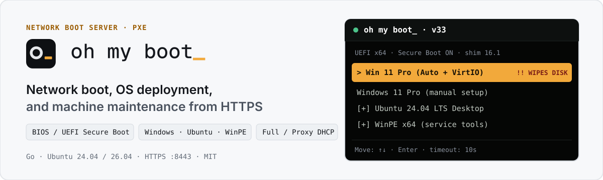
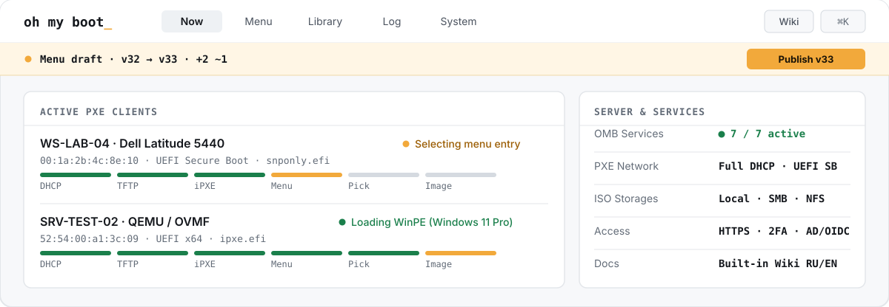
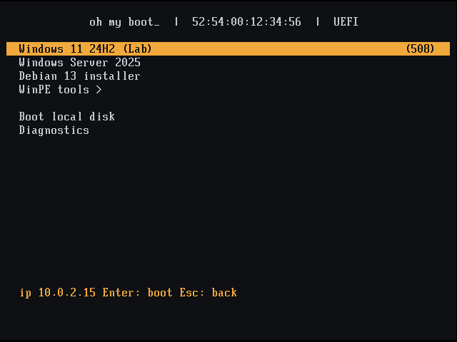
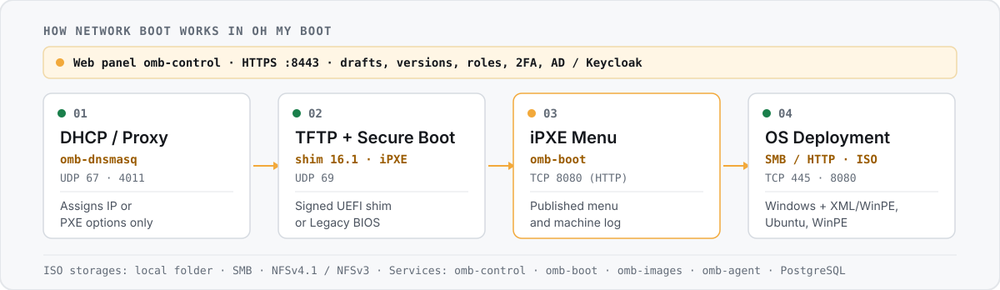

<p align="right">
  <a href="README.md">Русский</a> · <strong>English</strong>
</p>

<p align="center">
  <picture>
    <source media="(prefers-color-scheme: dark)" srcset="docs/images/readme/hero-en-dark.svg">
    
  </picture>
</p>

<p align="center">
  <a href="https://github.com/f0nwa/oh-my-boot_/actions/workflows/ci.yml"></a>
  <a href="https://github.com/f0nwa/oh-my-boot_/releases"></a>
  <a href="go.mod"></a>
  <a href="docs/en/installation.md"></a>
  <a href="https://github.com/f0nwa/oh-my-boot_/actions/workflows/ci.yml"></a>
  <a href="LICENSE"></a>
</p>

**oh my boot_ (OMB)** is a Linux network boot (PXE) server that serves a boot menu for BIOS and UEFI machines (including UEFI Secure Boot through signed `shim` + iPXE) and manages its contents from an HTTPS control panel: ISO libraries, Windows and Ubuntu installers, service WinPE images, answer files, WinPE drivers, and a log of every machine that booted. It works both on connected networks and in fully air-gapped environments.

---

## Table of Contents

- [Web Panel & Boot Menu](#web-panel--boot-menu)
- [Features](#features)
- [How It Works](#how-it-works)
- [Installation](#installation)
  - [Requirements & Ports](#requirements--ports)
  - [Install Methods](#install-methods)
  - [First Sign-In & `omb` CLI](#first-sign-in--omb-cli)
- [Documentation](#documentation)
- [Tested So Far](#tested-so-far)
- [Development & Verification](#development--verification)
- [License](#license)

---

## Web Panel & Boot Menu

The HTTPS web control panel (`omb-control`, `:8443`) uses an instrument-console design with light and dark themes, English and Russian UI, and a built-in knowledge base (`/wiki`):

<p align="center">
  <picture>
    <source media="(prefers-color-scheme: dark)" srcset="docs/images/readme/panel-en-dark.svg">
    
  </picture>
</p>

Real iPXE boot menu screenshot on a test virtual machine:

<p align="center">
  
</p>

---

## Features

- **Draft-based boot menu with rollback:** unified Legacy BIOS and UEFI menu, folders, an unpublished draft invisible to clients until published, version history, and snapshot rollback.
- **ISO catalog & storage backends:** local folders, SMB shares, and NFS exports (`NFSv4.1` / `NFSv3`), browser uploads, built-in SFTP/SMB upload receiver, periodic background rescans, live ISO migration between storages, and disk usage accounting.
- **Windows deployment (x64):** automatic WinPE media preparation when saving a boot entry, multiple independent `autounattend.xml` scenarios per ISO with a built-in visual answer file editor, and WinPE driver packages imported from a folder or ZIP.
- **Ubuntu Autoinstall:** immutable generated profiles with interactive storage, installer-selected disk erasure warnings, or exact-serial disk erasure; see the [operations guide](docs/en/control-installation.md#ubuntu-autoinstall).
- **Service WinPE environments:** network boot for WinPE maintenance images with injected drivers and read-only SMB media delivery.
- **UEFI Secure Boot & network drivers:** signed `shim 16.1 → iPXE` chain (Microsoft UEFI CA 2011 and 2023), global, per-machine, and MAC-prefix UEFI driver selection (`ipxe.efi` vs `snponly.efi`) without restarting DHCP, an SCCM preparation script, and a WinPE USB builder ([Secure Boot guide](docs/en/secure-boot.md)).
- **Machine inventory & live telemetry:** live **Now** view with stage-by-stage progress, HTTP/DHCP/TFTP and system event logs, automatic machine inventory with vendor and model, CSV import/export, and MAC-prefix rules.
- **Security & enterprise auth:** HTTPS, role-based access (`admin` / `operator` / `observer`), local accounts with password policy and TOTP 2FA (plus trusted browsers), Active Directory / LDAP and Keycloak (OIDC) sign-in, and built-in bilingual Wiki (`/wiki`).

---

## How It Works

<p align="center">
  <picture>
    <source media="(prefers-color-scheme: dark)" srcset="docs/images/readme/pipeline-en-dark.svg">
    
  </picture>
</p>

For systemd services, Unix sockets, the three PostgreSQL databases, and server path layout, see the [architecture guide](docs/en/architecture.md).

---

## Installation

Full step-by-step setup, UFW firewall configuration, and `omb-setup` walkthrough are in [docs/en/installation.md](docs/en/installation.md).

### Requirements & Ports

**Minimum and recommended server specifications:**

| Resource | Minimum *(external SMB/NFS for ISOs)* | Recommended *(local ISOs / concurrent installs)* |
| --- | --- | --- |
| **OS & architecture** | Ubuntu 26.04 LTS or 24.04 LTS (`amd64`) | Ubuntu 26.04 LTS (`amd64`) |
| **CPU** | 2 vCPU (`x86_64`) | 4+ vCPU *(faster `boot.wim` driver builds)* |
| **Memory (RAM)** | 2 GB | 4–8 GB *(PostgreSQL + Linux page cache for images)* |
| **Storage** | 20 GB *(OS, DBs, WinPE profiles)* | 60–100+ GB SSD *(headroom for local ISOs and artifacts)* |
| **Network** | 1 × 1 GbE with static IPv4 *(Proxy DHCP)* | 2 × 1 GbE+ *(dedicated Management and PXE NICs)* |

> **For PXE client machines:** 2–4 GB RAM is enough for WinPE and Windows Setup; Ubuntu Desktop PXE (`casper` loads the entire ISO into RAM) requires 8–16 GB RAM depending on the ISO size.

**Core ports:**

| Segment | Ports | Purpose |
| --- | --- | --- |
| **Management** | `TCP 8443` *(req.)*, `TCP 2022` *(SFTP)*, `TCP 445` *(SMB `[iso]`)* | `omb-control` HTTPS web panel and optional ISO upload services |
| **PXE** | `UDP 67`, `UDP 4011`, `UDP 69`, `TCP 8080`, `TCP 445` | DHCP / Proxy DHCP (`omb-dnsmasq`), TFTP, HTTP menu (`omb-boot`), Samba `[ombisos]` |

For the complete port table (including outbound NAS / AD / Keycloak / NTP ports) and ready-to-use `ufw` rules, see [Network ports and firewall](docs/en/installation.md#network-ports-and-firewall).

### Install Methods

**1. Online one-line install** *(recommended — downloads `.deb`, verifies `SHA256SUMS`, installs dependencies, and launches `omb-setup`)*:

```sh
curl -fsSL https://raw.githubusercontent.com/f0nwa/oh-my-boot_/main/scripts/install.sh | sudo bash
```

**2. Manual `.deb` install:**

```sh
sudo apt update
sudo apt install ./omb_<version>_amd64.deb
sudo omb-setup
```

**3. Offline air-gapped install (from a signed `apt-repo`):**

```sh
sudo bash scripts/offline-deploy.sh install <apt-repo> <public-key>
```

> Building signed offline repositories, air-gapped updates, and rollback are covered in [docs/en/offline-release.md](docs/en/offline-release.md) and [docs/en/offline-installation.md](docs/en/offline-installation.md).

### First Sign-In & `omb` CLI

Once `omb-setup` completes, open `https://<server-ip>:8443` and sign in as `admin` with the password you set.

For day-2 server operations from the terminal, use the `omb` CLI:

```sh
sudo omb status                  # version, channel, 7 services, and UFW status
sudo omb channel [stable|dev]    # inspect or switch release channel
sudo omb update                  # online update with DB backup and SHA-256 check
sudo omb reset-password [user]   # reset a local account password
sudo omb reset-2fa [user]        # reset a user's TOTP 2FA
```

---

## Documentation

All user guides are maintained in English and Russian (and embedded inside the server at `/wiki`).

| Guide | English | Русский |
| --- | --- | --- |
| **Server installation, ports, `omb-setup`, and `omb` CLI** | [docs/en/installation.md](docs/en/installation.md) | [docs/installation.md](docs/installation.md) |
| **Control panel, menu, deployments, roles, 2FA, AD / OIDC** | [docs/en/control-installation.md](docs/en/control-installation.md) | [docs/control-installation.md](docs/control-installation.md) |
| **ISO catalog, storages (Local / SMB / NFS), and Windows profiles** | [docs/en/images-installation.md](docs/en/images-installation.md) | [docs/images-installation.md](docs/images-installation.md) |
| **Answer file editor (`autounattend.xml`)** | [docs/en/answer-editor.md](docs/en/answer-editor.md) | [docs/answer-editor.md](docs/answer-editor.md) |
| **Architecture, services, databases, and boot pipeline** | [docs/en/architecture.md](docs/en/architecture.md) | [docs/architecture.md](docs/architecture.md) |
| **UEFI Secure Boot: signing chain and troubleshooting** | [docs/en/secure-boot.md](docs/en/secure-boot.md) | [docs/secure-boot.md](docs/secure-boot.md) |
| **Network boot paths (with diagrams)** | — | [docs/secure-boot-boot-paths.md](docs/secure-boot-boot-paths.md) |
| **Secure Boot: preparing domain laptops with SCCM** | [docs/en/secure-boot-sccm.md](docs/en/secure-boot-sccm.md) | [docs/secure-boot-sccm.md](docs/secure-boot-sccm.md) |
| **Ubuntu Desktop PXE guide** | [docs/en/ubuntu-desktop-pxe.md](docs/en/ubuntu-desktop-pxe.md) | [docs/ubuntu-desktop-pxe.md](docs/ubuntu-desktop-pxe.md) |
| **Windows 10 WinPE guide** | [docs/en/windows-winpe-pxe.md](docs/en/windows-winpe-pxe.md) | [docs/windows-winpe-pxe.md](docs/windows-winpe-pxe.md) |
| **Windows 11 WinPE guide** | [docs/en/windows11-winpe-pxe.md](docs/en/windows11-winpe-pxe.md) | [docs/windows11-winpe-pxe.md](docs/windows11-winpe-pxe.md) |
| **Offline `.deb` releases, updates, and rollback** | [docs/en/offline-release.md](docs/en/offline-release.md) | [docs/offline-release.md](docs/offline-release.md) |
| **Offline air-gapped installation bundle** | [docs/en/offline-installation.md](docs/en/offline-installation.md) | [docs/offline-installation.md](docs/offline-installation.md) |
| **Architecture & acceptance plan** | [docs/en/omb-design.md](docs/en/omb-design.md) | — |
| **Brand: mark, logos, and usage rules** | — | [docs/brand/README.md](docs/brand/README.md) |

---

## Tested So Far

- **Server installs & lifecycle:** verified on clean Ubuntu 26.04.1 LTS VMs for both online (`install.sh` + `omb-setup`) and air-gapped offline (`offline-deploy.sh install` + `omb-setup`) deployments, cumulative DB migrations (`schema_migrations`), `stable`/`dev` channel switching, and self-contained `rollback`.
- **Client PXE boots on VMs:** verified Ubuntu Desktop in Legacy BIOS (SeaBIOS) and UEFI (Secure Boot on and off), Windows 10 and Windows 11 Setup with visible disks in UEFI, full Windows 11 unattended install with `autounattend.xml` and VirtIO network/SCSI drivers, and UEFI driver overrides (`snponly.efi` / `ipxe.efi`).
- **In progress:** full repeat client regression on physical hardware (including vendor-specific Secure Boot checks on Dell, Lenovo, and HP laptops).

---

## Development & Verification

Run local tests and validation checks:

```sh
go test ./...
go vet ./...
./scripts/validate-ubuntu-autoinstall.sh testdata/autoinstall/interactive-user-data testdata/autoinstall/serial-user-data
scripts/fetch-ipxe_test.sh
```

---

## License

The source code is released under the [MIT License](LICENSE). The `oh my boot_` mark and its usage rules are documented in [docs/brand/README.md](docs/brand/README.md).
