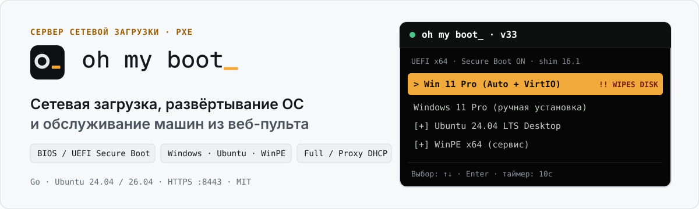
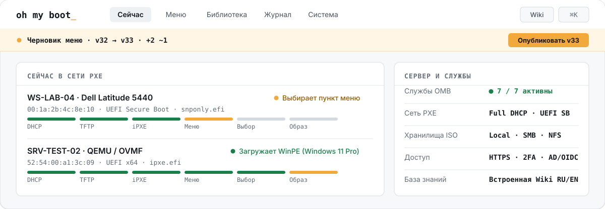
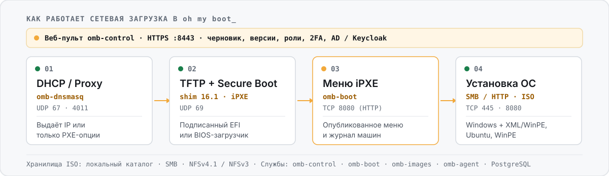

<p align="right">
  <strong>Русский</strong> · <a href="README.en.md">English</a>
</p>

<p align="center">
  <picture>
    <source media="(prefers-color-scheme: dark)" srcset="docs/images/readme/hero-ru-dark.svg">
    
  </picture>
</p>

<p align="center">
  <a href="https://github.com/f0nwa/oh-my-boot_/actions/workflows/ci.yml"></a>
  <a href="https://github.com/f0nwa/oh-my-boot_/releases"></a>
  <a href="go.mod"></a>
  <a href="docs/installation.md"></a>
  <a href="https://github.com/f0nwa/oh-my-boot_/actions/workflows/ci.yml"></a>
  <a href="LICENSE"></a>
  <a href="https://boosty.to/fonwa"></a>
</p>

**oh my boot_ (OMB)** — сервер сетевой загрузки (PXE) на Linux, который отдаёт загрузочное меню для BIOS и UEFI-машин (включая UEFI Secure Boot через подписанный `shim` + iPXE) и управляет его содержимым из веб-пульта по HTTPS: образами ISO, установщиками Windows и Ubuntu, сервисными WinPE, файлами ответов, драйверами и журналом машин. Работает как в обычных сетях с интернетом, так и в полностью изолированном контуре (air-gapped).

---

## Содержание

- [Интерфейс и загрузочное меню](#интерфейс-и-загрузочное-меню)
- [Возможности](#возможности)
- [Как это работает](#как-это-работает)
- [Установка](#установка)
  - [Требования и порты](#требования-и-порты)
  - [Способы установки](#способы-установки)
  - [Первый вход и консольная утилита `omb`](#первый-вход-и-консольная-утилита-omb)
- [Документация](#документация)
- [Что проверено](#что-проверено)
- [Разработка и проверка](#разработка-и-проверка)
- [Поддержка проекта](#поддержка-проекта)
- [Лицензия](#лицензия)

---

## Интерфейс и загрузочное меню

Веб-панель управления (`omb-control`, HTTPS `:8443`) построена в приборном стиле «Пульт» со светлой и тёмной темой, русским и английским языком и встроенной базой знаний (`/wiki`):

<p align="center">
  <picture>
    <source media="(prefers-color-scheme: dark)" srcset="docs/images/readme/panel-ru-dark.svg">
    
  </picture>
</p>

Пример реального загрузочного меню iPXE на тестовой виртуальной машине:

<p align="center">
  
</p>

---

## Возможности

- **Загрузочное меню с черновиком и откатом:** единое меню для Legacy BIOS и UEFI, папки, черновик (клиенты не видят изменения до публикации), история версий и восстановление прошлых снимков.
- **Каталог образов ISO и хранилища:** локальные папки, сетевые шары SMB и NFS (`NFSv4.1` / `NFSv3`), загрузка через браузер, встроенный SFTP/SMB-приёмник, фоновый рескан, перемещение образов между хранилищами и учёт занятого места.
- **Установка Windows (x64):** автоматическая подготовка профилей WinPE при сохранении пункта меню, независимые сценарии `autounattend.xml` (включая встроенный визуальный редактор файлов ответов), импорт драйверов WinPE из папки или ZIP.
- **Ubuntu Autoinstall:** генерация неизменяемых сценариев установки с интерактивной разметкой, предупреждением о стирании диска или выбором диска по серийному номеру; см. [руководство по панели управления](docs/control-installation.md#ubuntu-autoinstall).
- **Сервисные образы WinPE:** загрузка сервисных WinPE-сред по сети с подгрузкой драйверов и доступом к образам по read-only SMB-шаре.
- **UEFI Secure Boot и сетевые драйверы:** подписанная цепочка `shim 16.1 → iPXE` (Microsoft UEFI CA 2011 и 2023), выбор драйвера UEFI (`ipxe.efi` или `snponly.efi`) глобально, по конкретной машине и по MAC-префиксу без перезапуска DHCP, скрипт для SCCM и генератор сервисной USB-флешки WinPE ([подробнее о Secure Boot](docs/secure-boot.md)).
- **Журнал и учёт машин:** живой экран «Сейчас» с цепочкой этапов загрузки, история HTTP/DHCP/TFTP и системных событий, список всех машин с производителем и моделью, импорт/экспорт CSV и правила по MAC-префиксам.
- **Безопасность и интеграции:** HTTPS, роли (`admin` / `operator` / `observer`), локальные учётные записи с политикой паролей и 2FA (TOTP + доверенные браузеры), вход через Active Directory / LDAP и Keycloak (OIDC), встроенная двуязычная Wiki (`/wiki`).

---

## Как это работает

<p align="center">
  <picture>
    <source media="(prefers-color-scheme: dark)" srcset="docs/images/readme/pipeline-ru-dark.svg">
    
  </picture>
</p>

Подробное описание служб `systemd`, Unix-сокетов, трёх баз PostgreSQL и карты путей сервера — в [документации по архитектуре](docs/architecture.md).

---

## Установка

Полное пошаговое руководство по установке, настройке файрвола UFW и мастеру `omb-setup` — в [docs/installation.md](docs/installation.md).

### Требования и порты

**Минимальные и рекомендуемые характеристики сервера:**

| Параметр | Минимум *(внешний NAS для ISO)* | Рекомендуется *(локальные ISO / одновременные установки)* |
| --- | --- | --- |
| **ОС и архитектура** | Ubuntu 26.04 LTS или 24.04 LTS (`amd64`) | Ubuntu 26.04 LTS (`amd64`) |
| **Процессор (CPU)** | 2 vCPU (`x86_64`) | 4+ vCPU *(ускоряет сборку `boot.wim` с драйверами)* |
| **Оперативная память (RAM)** | 2 ГБ | 4–8 ГБ *(PostgreSQL + дисковый кэш образов)* |
| **Диск** | 20 ГБ *(ОС, БД, профили WinPE)* | 60–100+ ГБ SSD *(с запасом под локальные ISO и артефакты)* |
| **Сеть** | 1 × 1 Гбит/с, статический IPv4 *(Proxy DHCP)* | 2 × 1 Гбит/с+ *(раздельные сегменты Management и PXE)* |

> **Для загружаемых машин (PXE-клиентов):** для WinPE и установки Windows достаточно от 2–4 ГБ ОЗУ; для Ubuntu Desktop PXE (`casper` загружает ISO целиком в память) требуется от 8–16 ГБ ОЗУ в зависимости от размера образа.

**Основные порты:**

| Сегмент | Порты | Назначение |
| --- | --- | --- |
| **Management** | `TCP 8443` *(обяз.)*, `TCP 2022` *(SFTP)*, `TCP 445` *(SMB `[iso]`)* | Веб-панель `omb-control` (HTTPS) и опциональная загрузка ISO |
| **PXE** | `UDP 67`, `UDP 4011`, `UDP 69`, `TCP 8080`, `TCP 445` | DHCP / Proxy DHCP (`omb-dnsmasq`), TFTP, HTTP-меню (`omb-boot`), Samba `[ombisos]` |

Полная таблица (включая исходящие порты NAS / AD / Keycloak / NTP) и готовые правила `ufw` — в [разделе портов и файрвола](docs/installation.md#сетевые-порты-и-файрвол).

### Способы установки

**1. Онлайн-установка одной командой** *(рекомендуется — скачивает `.deb`, проверяет `SHA256SUMS`, ставит зависимости и запускает мастер `omb-setup`)*:

```sh
curl -fsSL https://raw.githubusercontent.com/f0nwa/oh-my-boot_/main/scripts/install.sh | sudo bash
```

**2. Ручная установка из `.deb`-пакета:**

```sh
sudo apt update
sudo apt install ./omb_<версия>_amd64.deb
sudo omb-setup
```

**3. Офлайн-установка (изолированный контур, из подписанного `apt-repo`):**

```sh
sudo bash scripts/offline-deploy.sh install <apt-repo> <public-key>
```

**4. Готовая ВМ для Proxmox VE / ESXi (`.qcow2.xz` и `.ova`, Ubuntu 24.04 LTS):**

В каждом релизе публикуются готовые образы ВМ с предустановленными `omb`, PostgreSQL, Samba, `dnsmasq`, `wimtools`, `qemu-guest-agent` и Cloud-Init (удобно и для быстрого старта, и для закрытого контура — без выхода в интернет). Развёртывание на ноде Proxmox одной командой:

```sh
curl -fsSL https://raw.githubusercontent.com/f0nwa/oh-my-boot_/main/scripts/proxmox-create-vm.sh | bash -s -- \
  --vmid 200 --storage local-lvm --bridge vmbr0 --pxe-bridge vmbr1
```

*(Для офлайн-ноды Proxmox передайте локальный файл `--image omb_<версия>_ubuntu24.04_amd64.qcow2.xz`, либо импортируйте `.ova` через веб-интерфейс Proxmox / ESXi — пошаговая инструкция приведена в [docs/installation.md](docs/installation.md#способ-4-готовая-вм-для-proxmox-ve--esxi-qcow2xz-и-ova). Консольный вход по умолчанию: `omb` / `omb` со сменой пароля при первом входе, затем запустите `sudo omb-setup`.)*

> Сборка подписанного локального репозитория, обновления без интернета и откат описаны в [docs/offline-release.md](docs/offline-release.md) и [docs/offline-installation.md](docs/offline-installation.md).

### Первый вход и консольная утилита `omb`

После завершения мастера `omb-setup` откройте веб-панель `https://<server-ip>:8443` и войдите под учётной записью `admin` с заданным паролем.

Для повседневного обслуживания сервера из консоли доступна утилита `omb`:

```sh
sudo omb status                         # версия, канал, статус 7 служб и UFW
sudo omb channel [stable|dev]           # просмотр и переключение канала обновлений
sudo omb update                         # онлайн-обновление с бэкапом БД и проверкой SHA-256
sudo omb update --deb ./omb_<ver>_amd64.deb  # обновление из локального .deb (+ SHA256SUMS рядом)
sudo omb reset-password [user]          # сброс пароля локальной учётной записи
sudo omb reset-2fa [user]               # сброс 2FA (TOTP) пользователя
```

---

## Документация

Вся пользовательская документация доступна на русском и английском языках (а также встроена внутрь самого сервера по адресу `/wiki`).

| Раздел | Русский | English |
| --- | --- | --- |
| **Установка сервера, порты, `omb-setup` и CLI `omb`** | [docs/installation.md](docs/installation.md) | [docs/en/installation.md](docs/en/installation.md) |
| **Веб-панель управления, меню, загрузки, роли, 2FA, AD / OIDC** | [docs/control-installation.md](docs/control-installation.md) | [docs/en/control-installation.md](docs/en/control-installation.md) |
| **Каталог ISO, хранилища (Local / SMB / NFS) и профили Windows** | [docs/images-installation.md](docs/images-installation.md) | [docs/en/images-installation.md](docs/en/images-installation.md) |
| **Редактор файлов ответов (`autounattend.xml`)** | [docs/answer-editor.md](docs/answer-editor.md) | [docs/en/answer-editor.md](docs/en/answer-editor.md) |
| **Архитектура, службы, базы данных и конвейер загрузки** | [docs/architecture.md](docs/architecture.md) | [docs/en/architecture.md](docs/en/architecture.md) |
| **UEFI Secure Boot: цепочка подписей и диагностика** | [docs/secure-boot.md](docs/secure-boot.md) | [docs/en/secure-boot.md](docs/en/secure-boot.md) |
| **Маршруты сетевой загрузки (схемы)** | [docs/secure-boot-boot-paths.md](docs/secure-boot-boot-paths.md) | — |
| **Secure Boot: подготовка доменных ноутбуков через SCCM** | [docs/secure-boot-sccm.md](docs/secure-boot-sccm.md) | [docs/en/secure-boot-sccm.md](docs/en/secure-boot-sccm.md) |
| **Сценарий Ubuntu Desktop PXE** | [docs/ubuntu-desktop-pxe.md](docs/ubuntu-desktop-pxe.md) | [docs/en/ubuntu-desktop-pxe.md](docs/en/ubuntu-desktop-pxe.md) |
| **Сценарий Windows 10 WinPE** | [docs/windows-winpe-pxe.md](docs/windows-winpe-pxe.md) | [docs/en/windows-winpe-pxe.md](docs/en/windows-winpe-pxe.md) |
| **Сценарий Windows 11 WinPE** | [docs/windows11-winpe-pxe.md](docs/windows11-winpe-pxe.md) | [docs/en/windows11-winpe-pxe.md](docs/en/windows11-winpe-pxe.md) |
| **Офлайн-выпуски `.deb`, обновления и откат** | [docs/offline-release.md](docs/offline-release.md) | [docs/en/offline-release.md](docs/en/offline-release.md) |
| **Комплект для первичной офлайн-установки** | [docs/offline-installation.md](docs/offline-installation.md) | [docs/en/offline-installation.md](docs/en/offline-installation.md) |
| **План архитектуры и приёмки** | — | [docs/en/omb-design.md](docs/en/omb-design.md) |
| **Брендбук: знак, логотипы и правила использования** | [docs/brand/README.md](docs/brand/README.md) | — |

---

## Что проверено

- **Серверная установка и обновления:** на чистых ВМ Ubuntu 26.04.1 LTS проверены онлайн-установка (`install.sh` + `omb-setup`), полностью офлайн-установка (`offline-deploy.sh install` + `omb-setup`), кумулятивные миграции БД (`schema_migrations`), смена каналов (`stable` / `dev`) и самодостаточный откат (`rollback`).
- **Сетевая загрузка ВМ:** подтверждены загрузка Ubuntu Desktop в Legacy BIOS (SeaBIOS) и UEFI (с Secure Boot и без), запуск установщиков Windows 10 и Windows 11 с видимыми дисками в UEFI, полная установка Windows 11 с пользовательским `autounattend.xml` и драйверами VirtIO (сеть + SCSI), а также переключение сетевых драйверов UEFI (`snponly.efi` / `ipxe.efi`).
- **На заметку:** полный повторный клиентский регресс на физических ноутбуках (включая специфические проверки Secure Boot на реальном железе Dell/Lenovo/HP) продолжается.

---

## Разработка и проверка

Локальный прогон тестов и проверок:

```sh
go test ./...
go vet ./...
./scripts/validate-ubuntu-autoinstall.sh testdata/autoinstall/interactive-user-data testdata/autoinstall/serial-user-data
scripts/fetch-ipxe_test.sh
```

---

## Поддержка проекта

Если `oh my boot_` экономит вам время и помогает в работе, поддержать дальнейшую разработку проекта можно на [Boosty](https://boosty.to/fonwa).

---

## Лицензия

Исходный код распространяется под лицензией [MIT](LICENSE). Знак `oh my boot_` и правила его использования описаны в [docs/brand/README.md](docs/brand/README.md).
