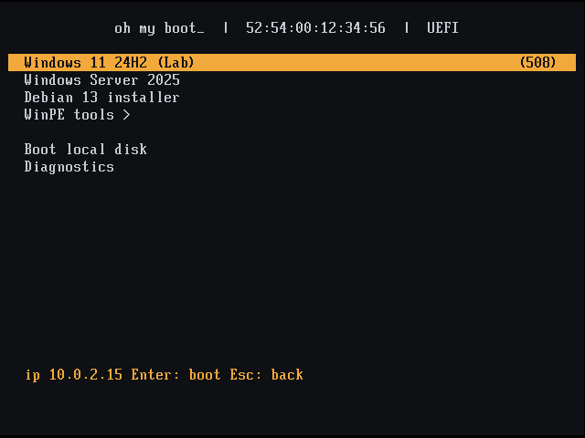

<p align="center">
  <picture>
    <source media="(prefers-color-scheme: dark)" srcset="docs/brand/logo/omb-logo-dark.svg">
    
  </picture>
</p>

# Oh My Boot

**Network boot, OS deployment, and machine maintenance.**

Oh My Boot (OMB) serves a network boot menu for BIOS and UEFI machines from an isolated Linux server and manages what that menu offers: Windows and Linux installers, answer files, WinPE drivers, and a log of every machine that booted. It works with full DHCP or alongside an existing DHCP server (proxy-DHCP), boots with UEFI Secure Boot on through signed iPXE files, and is administered from an HTTPS page with users and roles.

<p align="center"></p>

## What works

- **Boot menu** for BIOS and UEFI clients, with folders, a draft that clients do not see until it is published, version history and rollback.
- **Images:** an ISO catalog across local folders, SMB shares, and NFS exports (NFSv4.1/NFSv3), browser uploads, automatic Windows x64 media preparation when saving a boot entry. Source ISOs stay on their storage; Windows clients receive WinPE startup files over HTTP and installation media over a read-only SMB share.
- **Windows installs:** several independent `autounattend.xml` scenarios per ISO next to the manual installer, an answer file editor in the admin page, and WinPE driver packages imported from a folder or ZIP and built into separate menu entries.
- **Ubuntu Autoinstall:** immutable generated files with interactive storage, a warning for installer-selected disk erasure, or exact-serial disk erasure, selected per installation; see the [operations guide](docs/en/control-installation.md#ubuntu-autoinstall).
- **Boot entries** for Windows, Ubuntu Desktop and Strelec x64: choose a source image, title and menu folder, with WinPE drivers for Windows and Strelec, and answer files for installers. Preparation runs automatically; edit and retry from the same entry. Published menu versions retain their own component snapshots. Strelec uses its native PXE environment and applications from the read-only ISO share.
- **UEFI network drivers:** signed iPXE or firmware SNP, with a global default, per-machine choices and MAC-prefix overrides applied without restarting DHCP.
- **Machines:** every machine that reached the menu, with its model and maker, editable names, CSV import and export, and MAC-prefix rules.
- **Secure Boot:** a signed iPXE chain, a hint when firmware rejects the loader, an SCCM script and a WinPE USB stick (**Library → USB media**) that turn on the Microsoft UEFI CA key on Lenovo, Dell and HP laptops ([Secure Boot guide](docs/en/secure-boot.md)).
- **Admin page** in Russian and English, with a light, dark or system theme chosen by each user.

## Quick Start

Install OMB on Ubuntu 26.04 LTS amd64 (or Ubuntu 24.04 LTS amd64 for online installs) using one of three methods:

```sh
# 1. Online one-line install (downloads .deb, verifies SHA-256, launches omb-setup)
curl -fsSL https://raw.githubusercontent.com/f0nwa/OMB/main/scripts/install.sh | sudo bash

# 2. Manual .deb install
sudo apt update && sudo apt install ./omb_<version>_amd64.deb && sudo omb-setup

# 3. Offline air-gapped install (from a signed apt-repo)
sudo bash scripts/offline-deploy.sh install <apt-repo> <public-key>
```

After installation, open `https://<server-ip>:8443` and sign in as `admin`. For day-2 console administration on the server, use `sudo omb status | channel | update | reset-password`. See the full installation guide: [English](docs/en/installation.md) · [Русский](docs/installation.md).

## Tested so far

Test VMs reached the Ubuntu Desktop with SeaBIOS and with UEFI Secure Boot on and off, and the Windows 10 and Windows 11 installers with visible disks in UEFI. The Windows 10 profile also reached its installer and disk in SeaBIOS; a Windows 11 profile reached Setup in SeaBIOS, where Windows 11's UEFI and TPM requirements stopped installation on that VM. A Windows 11 installation with a user-supplied answer file completed and booted from disk, and a newly uploaded Windows 11 26H2 ISO reached disk selection. A Windows 11 entry with VirtIO network and SCSI drivers reached Setup with both disks visible in UEFI and, in SeaBIOS, WinPE with network, both disks and the mounted installer. Physical PXE clients and driver entries on real laptops remain to be checked. These detailed firmware results predate the unified-installations build. After the OMB transition, the user confirmed UEFI Secure Boot loading with XML and drivers; the full repeat client run is deferred until the main development work is complete. Strelec preparation now follows the native PXE recipe in the supplied ISO; client boot verification is recorded separately.

Network driver selection was verified on a UEFI VM: inherited firmware SNP and an explicit iPXE override both reached the menu. Physical Dell Secure Boot checks remain to be completed on real hardware.

Use the [current Control guide](docs/en/control-installation.md#installations-and-menu) for installation and operation.

## Guides

Start with the server installation guide ([EN](docs/en/installation.md) · [RU](docs/installation.md)) and [offline releases](docs/en/offline-release.md). The other guides are available in English and Russian:

| Guide | English | Русский |
| --- | --- | --- |
| Control and admin interface | [EN](docs/en/control-installation.md) | [RU](docs/control-installation.md) |
| Answer file editor | [EN](docs/en/answer-editor.md) | [RU](docs/answer-editor.md) |
| Images, ISO catalog and Windows profiles | [EN](docs/en/images-installation.md) | [RU](docs/images-installation.md) |
| Secure Boot: how the boot chain works | [EN](docs/en/secure-boot.md) | [RU](docs/secure-boot.md) |
| Network boot paths: iPXE, GRUB, Windows | — | [RU, with diagrams](docs/secure-boot-boot-paths.md) |
| Secure Boot: preparing domain laptops with SCCM | [EN](docs/en/secure-boot-sccm.md) | [RU](docs/secure-boot-sccm.md) |
| Ubuntu Desktop PXE | [EN](docs/en/ubuntu-desktop-pxe.md) | [RU](docs/ubuntu-desktop-pxe.md) |
| Windows 10 WinPE | [EN](docs/en/windows-winpe-pxe.md) | [RU](docs/windows-winpe-pxe.md) |
| Windows 11 WinPE | [EN](docs/en/windows11-winpe-pxe.md) | [RU](docs/windows11-winpe-pxe.md) |
| Architecture, services and boot pipeline | [EN](docs/en/architecture.md) | [RU](docs/architecture.md) |
| Architecture and acceptance plan | [EN](docs/en/omb-design.md) | — |
| Offline updates and `.deb` releases | [EN](docs/en/offline-release.md) | [RU](docs/offline-release.md) |
| Brand: mark, files and usage rules | — | [RU](docs/brand/README.md) |

## Development

For local verification:

```sh
go test ./...
go vet ./...
./scripts/validate-ubuntu-autoinstall.sh testdata/autoinstall/interactive-user-data testdata/autoinstall/serial-user-data
scripts/fetch-ipxe_test.sh
```

## License

The code is released under the [MIT License](LICENSE). The Oh My Boot mark and its files are described in [docs/brand](docs/brand/README.md).
