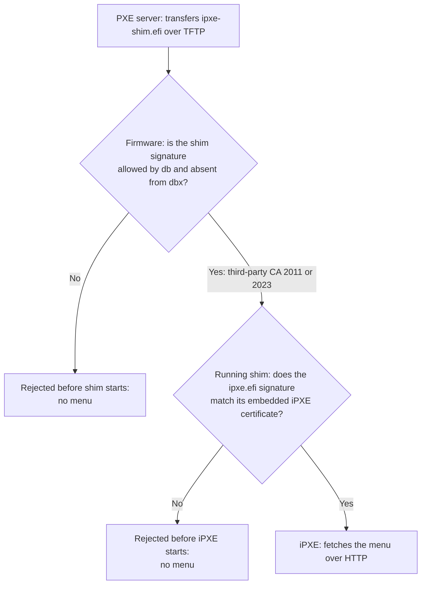

# Secure Boot: why PXE Platform boots without turning it off

## In short

With Secure Boot on, firmware runs only programs signed with a trusted key. The enrolled keys depend on the model and firmware settings: a Windows key may be present while the Microsoft key for third-party loaders is absent. PXE Platform uses a signed chain in which each executable stage is verified before it runs. Secure Boot can stay on when the firmware trusts the third-party loader key.

Some other PXE tools, such as iVentoy, boot the machine with their own unsigned loader. The firmware refuses it, so Secure Boot has to be turned off or a key added by hand on each machine.

## The boot chain

Think of a relay: each loader's signature is checked before control passes to it.

```
UEFI firmware (trusts the third-party UEFI CA 2011 or 2023)
  └─ ipxe-shim.efi        signed by Microsoft (third-party UEFI CAs 2011 and 2023)
       └─ ipxe.efi        signed with the iPXE project key, built into the shim
            ├─ Windows:  wimboot       signed with the iPXE key
            │              └─ Windows boot loader from boot.wim, signed by Microsoft
            └─ Ubuntu:   Ubuntu's shim  signed by Microsoft
                           └─ kernel signed by Canonical; GRUB is not used
```

1. **Firmware → shim.** A UEFI machine gets `ipxeboot/x86_64-sb/ipxe-shim.efi` from the server over the network (`sb` stands for Secure Boot). It is a small intermediate loader from the official iPXE build, signed by Microsoft. The firmware checks the signature with its Microsoft key and runs it.
2. **shim → iPXE.** The shim carries the iPXE project certificate (“iPXE Secure Boot CA”). It loads the `ipxe.efi` next to it, checks that it is signed with that key and runs it. From here iPXE works: it shows the menu and downloads the installation files over HTTP.
3. **iPXE → Windows.** To install Windows, iPXE runs wimboot (`windows/wimboot`, version 2.9.0), also signed with the iPXE key. wimboot places boot.wim in memory and starts the Windows boot loader from it, signed by Microsoft itself.
4. **iPXE → Ubuntu.** iPXE downloads the kernel and initrd. Its `shim` command configures Ubuntu's Microsoft-signed shim (`ubuntu/bootx64.efi`) for kernel verification under Secure Boot, and iPXE then boots the kernel. The current menu item does not use GRUB. With Secure Boot off, the `shim` command does nothing and does no harm.

### Who decides whether each stage can run



| Stage | Checker | Trust used | If validation fails |
|---|---|---|---|
| First EFI image, `ipxe-shim.efi` | Laptop firmware | Its `db` and `dbx`; our shim has alternative signatures from the third-party Microsoft UEFI CAs 2011/2023 | The shim cannot start even if TFTP transferred the file |
| `ipxe.efi` | The running iPXE shim | The iPXE public certificate embedded in shim | iPXE cannot start; adding a certificate only inside shim cannot fix a failure at the previous stage |
| Windows or Ubuntu menu entry | The loaders in that branch | The iPXE chain for `wimboot`; Ubuntu's signed shim and distribution key for Ubuntu | Failure occurs after the menu; its message depends on the stage |

`db` contains allowed certificates and hashes; `dbx` contains denials, which take precedence. `PK` establishes platform ownership and `KEK` authorizes changes to `db` and `dbx`: placing a certificate only in `PK` or `KEK` does not authorize an EFI image to run. Our shim needs a match for **one** of its signatures, not both. **Windows UEFI CA 2023** and the third-party **Microsoft UEFI CA 2023** are distinct certificates; the Windows certificate alone does not authorize the iPXE shim. [UEFI: image validation and signature databases](https://uefi.org/specs/UEFI/2.10/32_Secure_Boot_and_Driver_Signing.html), [Microsoft: certificate roles](https://learn.microsoft.com/en-us/windows-hardware/manufacture/desktop/windows-secure-boot-key-creation-and-management-guidance?view=windows-11), [iPXE: shim and iPXE boot order](https://ipxe.org/secboot).

Secure Boot validates executable boot stages, but **not every file transferred over the network**: receiving a menu, `initrd`, ISO, or `boot.wim` does not by itself mean that firmware verified all of its contents. A TFTP failure is a transfer problem, not a Secure Boot rejection. [iPXE: TFTP, shim, and menu roles](https://ipxe.org/secboot).

For diagrams comparing this path with Debian shim → GRUB and a possible direct Windows boot manager path, see the [network boot paths guide (in Russian)](../secure-boot-boot-paths.md).

Legacy BIOS machines get `ipxeboot/x86_64/undionly.kpxe`. BIOS has no Secure Boot and checks no signatures.

## What this means in practice

- **The current deployment uses prebuilt signed files.** A custom UEFI loader can run with Secure Boot if we sign it with our private key and enroll the corresponding certificate in each machine's firmware `db`. Without that trust, firmware rejects a custom build. Deploying our own trust across the fleet would require key management and verification of the full boot chain.
- **For Legacy BIOS a custom build is fine**, since Secure Boot is not involved.
- **Everything started from the menu must also pass signature validation.** Windows and Ubuntu are signed in the current chain. A custom utility or Linux image needs an appropriate signature and trust at its verification stage; Secure Boot rejects an unsigned executable.
- **Drivers we add to WinPE do not affect booting.** Windows checks them, not the firmware.

### Our own keys and exporting laptop keys

Windows can read `PK`, `KEK`, `db`, and `dbx`. These contain public certificates, hashes, and revocation lists, not the private keys used to sign EFI files. In an elevated PowerShell, save them to an accessible folder:

```powershell
foreach ($name in 'PK','KEK','db','dbx') {
    $path = Join-Path $env:TEMP "secureboot-$name.bin"
    [IO.File]::WriteAllBytes($path, (Get-SecureBootUEFI -Name $name -ErrorAction Stop).Bytes)
    Write-Host $path
}
```

For our own boot chain, we can generate a key pair, enroll its **public certificate** in each laptop's firmware `db`, and sign the **first EFI image** on the server with its private key. A custom shim can embed a certificate to verify the second stage. Modifying the current shim invalidates its Microsoft signatures, so a custom build needs a signature already trusted by firmware. A certificate embedded in shim does not replace firmware `db` trust for shim itself. Changing `db` on a deployed machine requires a permitted firmware procedure or an authenticated update; the method depends on the model. Preserve the Windows keys and the `db`/`dbx` update path. Before changing Secure Boot settings, make sure the BitLocker recovery key is available and suspend protection when needed. [Microsoft: Secure Boot key model](https://learn.microsoft.com/en-us/windows-hardware/manufacture/desktop/windows-secure-boot-key-creation-and-management-guidance?view=windows-11), [Get-SecureBootUEFI](https://learn.microsoft.com/en-us/powershell/module/secureboot/get-securebootuefi), [UEFI: updating `db`](https://uefi.org/specs/UEFI/2.10/32_Secure_Boot_and_Driver_Signing.html), [Microsoft: BitLocker and Secure Boot database changes](https://learn.microsoft.com/en-us/windows/security/operating-system-security/data-protection/bitlocker/bitlocker-overview-and-requirements-faq).

**Appending to `db` and replacing it are different operations.** Append keeps the existing entries, producing `Windows keys + vendor keys + our certificate`. Replace installs the supplied set instead: if it contains only our certificate, Windows may stop booting. `Set-SecureBootUEFI -AppendWrite` requests an append, but the flag alone does not authorize a change to a protected variable: a deployed machine needs an authenticated update or a permitted action in firmware setup. [UEFI: updating `db`](https://uefi.org/specs/UEFI/2.10/32_Secure_Boot_and_Driver_Signing.html), [Microsoft: `-AppendWrite`](https://learn.microsoft.com/en-us/powershell/module/secureboot/set-securebootuefi).

| Vendor | What its documentation confirms | What to check on our model |
|---|---|---|
| Dell | Some Latitude manuals distinguish `Append from File` from `Replace from File`; turning off `Custom Mode` discards custom changes | Menu labels, certificate format, and whether the entry persists across a reboot |
| Lenovo | Lenovo describes modifying Secure Boot `db` for custom loaders, `Custom Mode`, and `Restore Factory Keys`; restoring factory keys erases custom changes | Whether our ThinkPad can append without replacement and how its BIOS version handles the operation |

[Example Dell Latitude manual](https://www.dell.com/support/manuals/en-us/latitude-15-5590-laptop/latitude_5590_om/secure-boot-screen-options?guid=guid-10e2d556-4d8c-40f5-a192-a95aa791e1a1&lang=en-us), [Lenovo ThinkPad Secure Boot paper](https://download.lenovo.com/pccbbs/mobiles_pdf/lenovo_thinkpad_x250_bios_security_white_paper.pdf). These documents establish behavior for the **named models**, not every Dell or Lenovo. The model-specific investigation is tracked in the [TODO](../../TODO.md).

## If a machine does not boot

### What it looks like

On the machine's screen, after the lines about downloading the loader:

```
NBP file downloaded successfully.
BdsDxe: failed to load Boot0001 "UEFI PXEv4 ..." : Access Denied
```

The machine then tries IPv6 or the next boot device, and our menu never appears. Other models say “Security Violation” or “Image authorization failed” instead of “Access Denied”.

In the panel, on the “Now” tab, DHCP and TFTP are green and the iPXE step is red with the note “rejected by firmware”. On the machine's page the outcome is “Firmware rejected the loader”. The panel shows this when the machine downloaded `ipxe-shim.efi` but did not ask for the next file, `ipxe.efi`, within 30 seconds. This is **evidence of failure before iPXE, not proof of its cause**: firmware may have rejected shim, but shim could also have failed before requesting the second file. Inspect the laptop screen and `db`/`dbx`.

### Why

With Secure Boot on, the firmware starts a file only if its signature is allowed by its trust database (`db`) and not blocked by `dbx`. Since 29 October 2026 our `ipxe-shim.efi` has two signatures, **Microsoft Corporation UEFI CA 2011** and **Microsoft UEFI CA 2023**, both for third-party loaders. Firmware that trusts only Windows keys still rejects it before the shim starts.

A certificate embedded in the shim does not make firmware trust that shim: firmware checks it before it can run. Trust for the first EFI image must be in firmware `db`; using our own signature means enrolling its public certificate in each machine's `db`. A Ventoy loader signed only by a third-party UEFI CA gets the same refusal on a laptop without that CA. Ventoy's “Enroll key” works only after the shim has started, so it does not help here.

### What to do

Any one of the three, once per machine.

**1. Allow Microsoft's key for third-party loaders (recommended).** In the Secure Boot settings turn on the option about “3rd party” or “Microsoft UEFI CA”. Secure Boot stays on, and the machine trusts signed shims: ours and Linux ones. Names depend on the model and BIOS version; examples:

| Vendor | Where to look |
|---|---|
| Lenovo (ThinkPad, ThinkCentre) | Security → Secure Boot → “Allow Microsoft 3rd Party UEFI CA” → On |
| Dell | Secure Boot → “Enable Microsoft UEFI CA” (on some models under Expert Key Management) |
| HP | Advanced → Secure Boot Configuration → “Enable MS UEFI CA key” |
| Microsoft Surface | UEFI → Security → Secure Boot → “Microsoft & 3rd party CA” |

For domain laptops this option can be turned on from Windows with a script through SCCM, without entering the BIOS: see [secure-boot-sccm.md](secure-boot-sccm.md).

For machines outside the domain, or with a foreign or broken Windows, use the USB stick from the admin page: it boots with Secure Boot on and turns this option on after you confirm (see [below](#usb-stick-for-machines-outside-the-domain)).

If there is no such option, look for a key mode like “Factory Keys” or “Restore Factory Keys”: on some models the standard set already contains the key.

**2. Add our loader to the trusted list by hand.** Some BIOSes offer “Enroll EFI Image”, “Add Trusted File” or “Append Image Hash”. Copy `ipxe-shim.efi` from the server (`/srv/pxe/tftp/ipxeboot/x86_64-sb/`) to a FAT32 USB stick, pick it in that BIOS option and save. The firmware remembers the fingerprint of exactly this file; if the shim on the server is updated, repeat this. Not every vendor has the option, and it usually works only from a USB stick or disk, not over the network.

**3. Turn Secure Boot off.** The simplest, but it turns the protection off completely. Fine for a test bench or a machine that joins the regular fleet after installation: Secure Boot can be turned back on afterwards, and Windows boots with it.

### USB stick for machines outside the domain

**Library → USB media** (or **USB media →** next to a prepared profile under ISO images): choose the WinPE image and the boot loader; the summary on the right has **Download the archive**. The admin page builds `pxe-uefica-<profile>-<2011|2023>.zip` from that ISO's WinPE (about 600 MB; the first build takes up to a minute, later downloads come from a cache). Unpack it into the root of a FAT32 USB stick (MBR or GPT) and boot the machine from it with the boot menu (F12). Secure Boot may stay on: WinPE is signed with the Windows key. All roles can download it; the audit log records `uefica-usb.download`.

On screen (in English, with the keyboard switched to US):

- manufacturer, model, serial number, Secure Boot, the option state, whether a BIOS password is set;
- if the option is off: a BitLocker warning and the question "Y or N, then Enter";
- if a BIOS administrator password is set (or the BIOS refused without one): the password prompt, at most two attempts, the screen is cleared after each; the password is not stored anywhere;
- after a change the machine restarts in 10 seconds; otherwise "R, Enter" restarts and a plain Enter opens a command prompt.

| Code | Meaning |
|---|---|
| 20 | option turned on, restart (not 0 on purpose: a crashed script may leave 0, which must not restart the machine) |
| 10 | already on, or Secure Boot not in use (BIOS/CSM mode) |
| 2 | not Lenovo/Dell/HP, or the model has no such option |
| 3 | the BIOS did not accept the password |
| 1 | WMI error or a script failure; any other code is treated as an error too |

The stick's boot loader is chosen at download: **PCA 2011** is the ISO's loader and fits almost all machines; **UEFI CA 2023** is `bootmgfw_EX.efi` from `boot.wim` (as Microsoft's `Make2023BootableMedia.ps1` does), for machines where the 2011 loader is already revoked. One stick cannot serve both: the firmware starts only `efi/boot/bootx64.efi`, and Microsoft does not sign the Windows loader with both keys at once.

Limits: BitLocker cannot be suspended from WinPE, so Windows asks for the recovery key once after the change; the logic is VBScript (WinPE has no PowerShell), and if Microsoft removes VBScript from WinPE the fallback is a PowerShell stick built with the ADK; Dell over WMI means models from 2018 on. The vendor logic is the same as in the [SCCM script](secure-boot-sccm.md); WMI stub scenarios are in `internal/ueficausb/testdata/uefica-tests.cmd` (on Windows, or on Linux with Wine: `UEFICA_WINE=1 wine cmd /c uefica-tests.cmd`).

### Other causes

- **Firmware with empty keys.** Virtual machines sometimes use firmware without Microsoft's keys. In Proxmox, “Pre-Enroll keys” must be ticked when creating the EFI disk.
- **The TFTP step is red, not iPXE.** Then the loader never reached the machine and Secure Boot is not involved: check the network and DHCP settings.

### How to reproduce on a virtual machine

Strict “Secured-core” firmware can be built for a test VM in Proxmox, which helps to check the panel or a new loader version. On the Proxmox host:

```
# a diskless VM booting from the network only; use the bridge PXE runs on
qm create 950 --name sb-strict-test --machine q35 --bios ovmf --cores 2 --memory 4096 \
  --net0 virtio,bridge=vmbr0 --boot order=net0 \
  --efidisk0 local-lvm:1,efitype=4m,pre-enrolled-keys=1
qm set 950 --rng0 source=/dev/urandom

# a fresh virt-firmware: the Proxmox package lacks the needed flags
apt install -y python3-venv
python3 -m venv /root/vf-26.10
/root/vf-26.10/bin/python -m pip install 'virt-firmware==26.10'

# Windows-only keys: no Microsoft UEFI CA
/root/vf-26.10/bin/virt-fw-vars --input /usr/share/pve-edk2-firmware/OVMF_VARS_4M.fd \
  --output /root/sb-windows-only.fd \
  --enroll-microsoft --microsoft-db win11 --microsoft-kek all --sb

# write it to the stopped VM's EFI disk and start it
dd if=/root/sb-windows-only.fd of=$(pvesm path local-lvm:vm-950-disk-0) bs=1M conv=notrunc
qm start 950
```

The VM gets “Access Denied”, like a Secured-core laptop. In `virt-firmware` 26.10, the `win11` profile includes the Windows 2011 and 2023 certificates but excludes the Microsoft UEFI CA certificates for third-party loaders. To check fix 1, build the keys with `--microsoft-db all` instead of `win11`, write them with the same `dd` command and start the VM: the menu loads with Secure Boot on. Verified on 23.10.2026. On the test host on 28.10.2026, VM 950 also needed VirtIO RNG for OVMF to expose network boot.

## The 2011 and 2023 keys

Microsoft is rotating its Secure Boot keys: **Microsoft UEFI CA 2023** is replacing **Microsoft Corporation UEFI CA 2011**, both for third-party loaders. Firmware does not check key expiry, so loaders signed with the 2011 key keep working wherever that key is in db.

What was checked on the test server:

- **Since 29 October 2026** the server serves the [official iPXE shim 16.1](https://github.com/ipxe/shim/releases/tag/ipxe-16.1), signed by Microsoft Corporation UEFI CA 2011 and Microsoft UEFI CA 2023. SHA-256: `5eecca2780bd49c900565e124516a1bd666ec5e012825f34991b6ba1ef2fa6cf`. Both signatures were checked with `sbverify --list`. Its loaded sections and embedded iPXE certificate matched the previous shim. The iPXE-signed `ipxe.efi` and `snponly.efi` from v2.0.0 were not changed.
- **TFTP was checked:** `ipxe-shim.efi` downloads with that SHA-256. The old shim is backed up at `/var/backups/pxe-platform-ipxe-dualsign-20261029/shimx64.efi` (SHA-256 `83ad71c7d4f2cf328b75b653d09bf3bea5f29bee2e67ca058f37d83c07133885`). A VM boot with only the third-party 2023 CA remains untested.
- **We cannot add a Microsoft signature ourselves.** Microsoft signs with its private key. Modifying an already signed shim invalidates its existing signatures. We can sign our own build with our own key, but its public certificate must be enrolled in firmware `db` for the first boot stage.
- **The new shim does not help a Windows-only `db`.** Such firmware has Windows keys but neither third-party CA. It still needs a firmware option or the [SCCM script](secure-boot-sccm.md).
- The dual signature matters for firmware that trusts only the 2023 third-party CA. Certificate expiry alone does not force rejection; the firmware checks `db` trust and `dbx` revocations.

Both pinned download sources are in the [boot assets guide](../../deploy/boot-assets/README.md). A VM test with three key sets (third-party 2023 only, third-party 2011 only, Windows only) remains in the [TODO](../../TODO.md).

## How the lab switch differs from iVentoy's EFI file choice

iVentoy lets you pick which EFI file to send to machines. Its loader is unsigned, so the file is matched to the firmware. In the main PXE Platform mode, the chain is signed and all UEFI clients receive the same iPXE loader. The lab now has a global **iPXE / GRUB** choice to test [a separate Debian chain](../grub-secure-boot-test.md); it changes the boot file for every UEFI client and does not select one for a particular firmware.

The choice that does matter is iPXE's network driver. `ipxe.efi` has its own network card drivers, while `snponly.efi` uses the firmware's driver. Some hardware (USB-C docks, USB adapters, some new network cards) works only with the latter. Both are signed and started through the shim, so choosing between them does not affect Secure Boot. It is planned per machine, model or vendor (by MAC prefix): stage 5 of the [machine list plan](../superpowers/plans/2026-10-23-machine-book.md).

## How to check what the server serves

The signatures can be seen in the files themselves, for example with `strings -a`:

- `/srv/pxe/tftp/ipxeboot/x86_64-sb/ipxe-shim.efi` contains `Microsoft Corporation UEFI CA 2011` and `iPXE Secure Boot CA`;
- `/srv/pxe/tftp/ipxeboot/x86_64-sb/ipxe.efi` contains `iPXE Secure Boot Automatic Code Signing`;
- `/srv/pxe/tftp/windows/wimboot` is `wimboot v2.9.0` with a signature in the file.

More: [iPXE — UEFI Secure Boot](https://ipxe.org/secboot), [the shim command](https://ipxe.org/cmd/shim).
