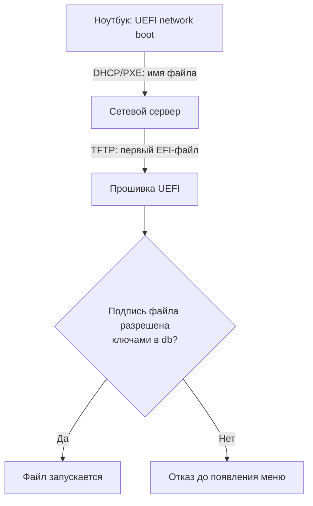
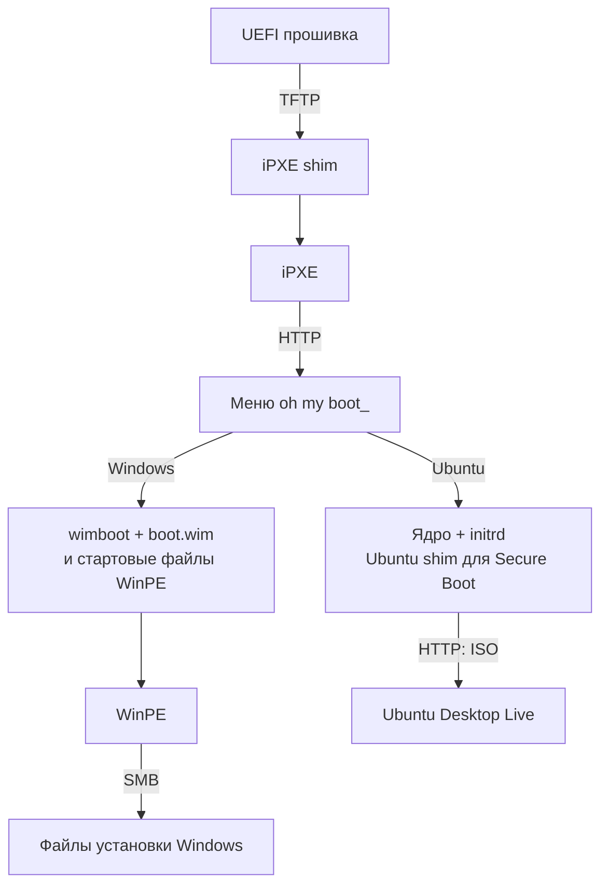
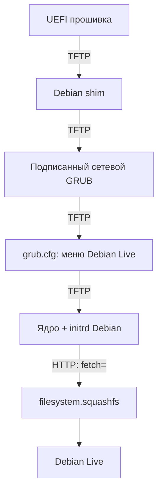
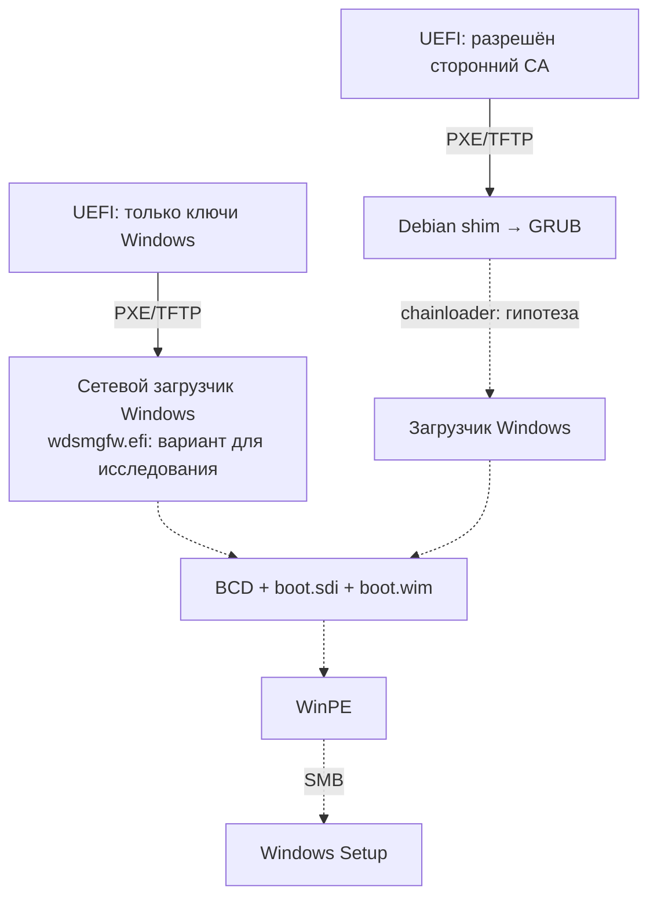

# Сетевая загрузка с Secure Boot: iPXE, GRUB и Windows

Для проверки альтернативной цепочки Debian shim → сетевой GRUB → Debian Installer см. архивные материалы по тестовому маршруту GRUB. В сетевых настройках переключение действует сразу для всех UEFI x64 клиентов; это отдельное тестовое меню.

Зафиксировано 28 октября 2026 года. Эта заметка сопоставляет **реализованные цепочки** oh my boot_ и стенда из переписки с **вариантами, которые пока требуют проверки**. Схемы показывают порядок запуска, а не обещают совместимость с любым ноутбуком. Кто проверяет подпись на каждом этапе, каким сертификатом и что означает отказ, объясняет [схема доверия Secure Boot](secure-boot.md#кто-принимает-решение-о-запуске).

## Термины и первая проверка

**PXE** здесь означает начало сетевой загрузки через прошивку и получение имени первого загрузочного файла. **TFTP** и **HTTP** передают файлы; **iPXE** и **GRUB** исполняют меню. Фраза «без PXE» в переписке описывает отсутствие программы *iPXE*: получение первого EFI-файла по сети всё равно остаётся PXE-загрузкой. Прошивка может получить этот файл по TFTP, но Secure Boot решает, разрешено ли **его выполнить**, по базе доверенных подписей `db`. [Microsoft: ключи Secure Boot](https://learn.microsoft.com/en-us/windows-hardware/manufacture/desktop/windows-secure-boot-key-creation-and-management-guidance?view=windows-11), [Microsoft: процесс PXE-загрузки](https://learn.microsoft.com/en-us/troubleshoot/mem/configmgr/os-deployment/understand-pxe-boot).

Схемы ниже относятся к UEFI x64 с включённым Secure Boot. Если Secure Boot выключен, прошивка не проверяет эти подписи, но сеть и загрузочные файлы всё равно должны работать. В Legacy BIOS Secure Boot нет; oh my boot_ отдаёт ему `undionly.kpxe`. [Конфигурация oh my boot_](../internal/network/dnsmasq.go).

Ключ **Microsoft Corporation UEFI CA 2011** и его преемник **Microsoft UEFI CA 2023** предназначены для сторонних UEFI-программ; ключи **Microsoft Windows Production PCA 2011** и **Windows UEFI CA 2023** — для загрузки Windows. Microsoft описывает конфигурацию прошивки, допускающую только Windows, без сторонних CA. Если конкретный ноутбук не доверяет ни одному CA, которым подписаны доступные shim, замена iPXE на Debian GRUB ничего не меняет: отказ произойдёт **раньше запуска GRUB**. Проверять надо фактический набор ключей конкретной модели и подпись конкретного EFI-файла. [Microsoft: содержимое `db` и варианты для Windows-only устройств](https://learn.microsoft.com/en-us/windows-hardware/manufacture/desktop/windows-secure-boot-key-creation-and-management-guidance?view=windows-11).

## 1. Текущий путь oh my boot_

Для UEFI [конфигурация DHCP/PXE](../internal/network/dnsmasq.go) выдаёт `ipxeboot/x86_64-sb/ipxe-shim.efi`. Этот подписанный shim загружает парный `ipxe.efi`; затем iPXE получает меню и файлы по HTTP. Такую последовательность описывает сам проект iPXE. Пункт Windows в [генераторе меню](../internal/control/menu_tree.go) загружает `wimboot`, `boot.wim` и стартовые файлы WinPE. Пункт Ubuntu в [генераторе меню](../internal/control/menu.go) загружает ядро и `initrd`, затем командой iPXE `shim` подключает подписанный Ubuntu shim для проверки загрузки. **GRUB не показывает текущее меню Ubuntu.** [iPXE: Secure Boot](https://ipxe.org/secboot), [iPXE: команда `shim`](https://ipxe.org/cmd/shim), [iPXE: `wimboot`](https://ipxe.org/wimboot).

До 29 октября 2026 года установленный iPXE shim имел подпись только Microsoft Corporation UEFI CA 2011. Сейчас сервер выдаёт [официальный iPXE shim 16.1](https://github.com/ipxe/shim/releases/tag/ipxe-16.1) с подписями сторонних CA 2011 и 2023; его SHA-256 `5eecca2780bd49c900565e124516a1bd666ec5e012825f34991b6ba1ef2fa6cf`. Проверенный Debian `bootnetx64.efi` тоже имеет обе подписи. Состав обоих файлов сверяли `sbverify --list` на сервере. Поэтому одно только наличие стороннего CA 2023 больше не даёт Debian преимущества перед текущим iPXE на первом шаге. Подпись файла со стенда коллеги в переписке не проверялась; остаются различия в сетевом коде и следующем этапе загрузки. [Подробности установки и проверки](secure-boot.md#ключи-2011-и-2023).

**Статус:** текущая реализация. [README](../README.md) сообщает о проверке Ubuntu и установщиков Windows на тестовых ВМ, включая UEFI Secure Boot; физический клиент PXE ещё не проверен. Источник по `wimboot` подтверждает сам механизм WinPE по HTTP, но результаты проекта относятся только к его стенду. [iPXE: `wimboot`](https://ipxe.org/wimboot).

## 2. Стенд коллеги: Debian shim → сетевой GRUB

В заметке о тестовом стенде сохранены сведения о пакетах `shim-signed` и `grub-efi-amd64-signed`, [снимок файлов](images/debian-grub-stand/tftp-files.jpg) и описание конфигураций GRUB и Caddy. В каталоге TFTP находились `bootx64.efi`, `grubx64.efi`, `grub/grub.cfg`, ядро и `initrd`; меню передавало ядру `fetch=http://…/filesystem.squashfs`, а Caddy отдавал SquashFS по HTTP. Значит, «только TFTP» относится к начальным файлам, а не к загрузке всей Live-системы. Официальный пример Debian использует именно подписанный shim и сетевой `grubnetx64.efi.signed`; документация `live-boot` описывает параметр `fetch=` для скачивания SquashFS. [Debian: Secure Boot и PXE](https://wiki.debian.org/SecureBoot/VirtualMachine), [Debian: `live-boot`](https://dyn.manpages.debian.org/bookworm/live-boot-doc/live-boot.7).

Сохранённые материалы не содержат настройки DHCP с именем первого EFI-файла и проверки подписей этих двух файлов. Указанная цепочка следует из слов коллеги, состава каталога и результата загрузки; точные бинарные файлы нужно сверить на его стенде.

**Статус:** коллега показал [запущенный Debian Live с включённым Secure Boot](images/debian-grub-stand/debian-live-secure-boot.jpg) на Dell. Это подтверждает его стенд, но не совместимость со всеми Dell и Lenovo. Заметка о проверке фиксирует, что успешной проверки Lenovo с заводскими настройками нет, а установка Windows с SMB обсуждалась как план, без результата запуска через GRUB.

## 3. Windows через GRUB или напрямую

Команда GRUB `chainloader` умеет передать управление EFI-программе. Это **не подтверждает**, что Windows Boot Manager, запущенный из сетевого GRUB, найдёт нужные BCD, `boot.sdi` и `boot.wim` или сохранит рабочий сетевой контекст. Для такого пункта потребуется отдельный прототип на конкретной подписанной сборке GRUB и проверка Secure Boot, загрузки WinPE и доступа к SMB. Нынешний пункт `wimboot` нельзя перенести в `grub.cfg` как текст. [GNU GRUB: `chainloader`](https://www.gnu.org/software/grub/manual/grub/html_node/chainloader.html), [Microsoft: загрузочные файлы WinPE](https://learn.microsoft.com/en-us/troubleshoot/mem/configmgr/os-deployment/understand-pxe-boot), [iPXE: `wimboot`](https://ipxe.org/wimboot).

Для прошивки, доверяющей только ключам Windows, отдельная гипотеза — отдавать первым файлом подписанную **сетевую** EFI-программу Windows (`wdsmgfw.efi` в схеме WDS/Configuration Manager), затем штатные загрузочные файлы и подготовленный WinPE. В документации Microsoft этот сетевой путь существует, но **oh my boot_ его пока не реализует**; нельзя считать, что достаточно подменить `ipxe-shim.efi` на произвольный `bootmgfw.efi`. После WinPE установщик может читать файлы с SMB, как в текущем проекте. [Microsoft: UEFI network boot programs и WinPE](https://learn.microsoft.com/en-us/troubleshoot/mem/configmgr/os-deployment/understand-pxe-boot), [Microsoft: Windows Setup с сетевого ресурса](https://learn.microsoft.com/en-us/windows/deployment/wds-boot-support).

Пунктирные стрелки означают **ещё не проверенный в oh my boot_ сценарий**. Для Windows 11 Microsoft отдельно ограничивает запуск Windows Setup в режиме WDS из обычного `boot.wim` установочного ISO; подготовленный WinPE и запуск Setup с сетевого ресурса остаются поддерживаемым направлением. Это ограничение нельзя автоматически переносить на текущий сценарий проекта с `wimboot` и собственными стартовыми файлами. [Microsoft: поддержка WDS `boot.wim`](https://learn.microsoft.com/en-us/windows/deployment/wds-boot-support).

## Что выбрать для проверки

| Сценарий | Что подтверждено | Что ещё нужно проверить |
|---|---|---|
| iPXE → Windows/Ubuntu | Реализован; тестовые ВМ в oh my boot_ | Физические ноутбуки и их сетевые адаптеры |
| Debian shim → GRUB → Debian Live | Debian Live и GRUB на одном Dell с Secure Boot; состав бинарных файлов следует из переписки | Нужные модели Lenovo; состав их ключей Secure Boot; подписи файлов стенда |
| Debian shim → GRUB → Windows | Возможность `chainloader` как механизма | Весь сетевой путь до WinPE и SMB; в переписке результата нет |
| Загрузчик Windows → WinPE напрямую | Описан Microsoft для сетевого развёртывания | Реализация в oh my boot_ и тест на Windows-only прошивке |

Если **первый EFI-файл отвергнут прошивкой**, менять программу меню бесполезно: надо установить причину по `db`/`dbx` и подписи файла. Если shim прошёл, но iPXE теряет сеть, GRUB может быть полезным альтернативным маршрутом; это отдельная аппаратная проверка, а не гарантия. [Microsoft: Secure Boot `db`/`dbx`](https://learn.microsoft.com/en-us/windows-hardware/manufacture/desktop/windows-secure-boot-key-creation-and-management-guidance?view=windows-11), [iPXE: варианты сетевых драйверов](https://ipxe.org/secboot).
