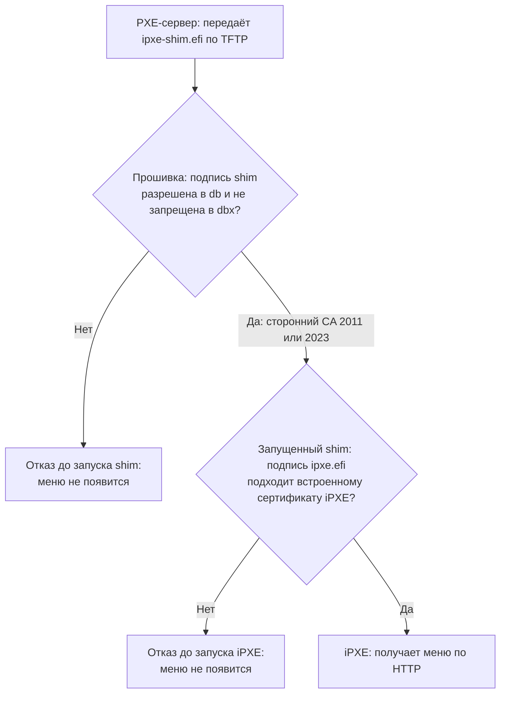

# Secure Boot: почему Oh My Boot грузится без его отключения

> Руководство использует текущие имена OMB. Состояние стенда и оставшиеся проверки: [отчёт](research/2026-10-31-omb-technical-migration.md).

## Коротко

На машине с включённым Secure Boot прошивка запускает только программы, подписанные доверенным ключом. Набор ключей зависит от модели и настроек BIOS: ключ Windows может присутствовать, а ключ Microsoft для сторонних загрузчиков — отсутствовать. Oh My Boot использует подписанную цепочку: перед запуском каждого исполняемого звена проверяется его подпись. Если прошивка доверяет ключу для сторонних загрузчиков, Secure Boot выключать не нужно.

Некоторые другие PXE-решения, например iVentoy, грузят машину своим неподписанным загрузчиком. Прошивка его не пропускает, и Secure Boot приходится выключать или вручную добавлять ключ на каждую машину.

## Цепочка загрузки

Как эстафета: прежде чем передать управление следующему загрузчику, проверяют его подпись.

```
Прошивка UEFI (доверяет стороннему UEFI CA 2011 или 2023)
  └─ ipxe-shim.efi        подписан Microsoft (сторонние UEFI CA 2011 и 2023)
       └─ ipxe.efi        подписан ключом проекта iPXE; ключ зашит в shim
            ├─ Windows:  wimboot      подписан ключом iPXE
            │              └─ загрузчик Windows из boot.wim — подписан Microsoft
            └─ Ubuntu:   shim Ubuntu  подписан Microsoft
                           └─ ядро — подписано Canonical; GRUB не используется
```

1. **Прошивка → shim.** Машина в режиме UEFI получает от сервера по сети `ipxeboot/x86_64-sb/ipxe-shim.efi` (`sb` значит Secure Boot). Это маленький загрузчик-посредник из официальной сборки iPXE, подписанный Microsoft. Прошивка проверяет подпись своим ключом Microsoft и запускает его.
2. **shim → iPXE.** Внутри shim зашит сертификат проекта iPXE («iPXE Secure Boot CA»). shim загружает соседний `ipxe.efi`, проверяет, что он подписан этим ключом, и запускает. Дальше работает iPXE: показывает меню и скачивает файлы установки по HTTP.
3. **iPXE → Windows.** Для установки Windows iPXE запускает wimboot (`windows/wimboot`, версия 2.9.0), тоже подписанный ключом iPXE. wimboot подставляет в память boot.wim и запускает из него загрузчик Windows, подписанный самой Microsoft.
4. **iPXE → Ubuntu.** iPXE скачивает ядро и `initrd`, а командой `shim` подключает подписанный Microsoft загрузчик Ubuntu (`ubuntu/bootx64.efi`) для проверки ядра при Secure Boot. Затем iPXE запускает ядро. В текущем пункте меню GRUB не используется. Если Secure Boot выключен, команда `shim` ничего не делает и не мешает.

### Кто принимает решение о запуске



| Шаг | Кто проверяет | Чем проверяет | Если проверка не пройдена |
|---|---|---|---|
| Первый EFI-файл `ipxe-shim.efi` | Прошивка ноутбука | Её `db` и `dbx`; у нашего shim две альтернативные подписи сторонних Microsoft UEFI CA 2011/2023 | shim не запускается, даже если TFTP передал файл |
| `ipxe.efi` | Уже запущенный iPXE shim | Публичным сертификатом iPXE, встроенным в shim | iPXE не запускается; добавление сертификата только в shim не исправляет отказ на предыдущем шаге |
| Windows или Ubuntu из меню | Загрузчики соответствующей ветки | Для `wimboot` — цепочка iPXE; для Ubuntu — её подписанный shim и ключ дистрибутива | Сбой возникает после появления меню; точное сообщение зависит от этапа |

`db` — список разрешённых сертификатов и хешей, `dbx` — запретов; запрет имеет приоритет. `PK` определяет владельца платформы, а `KEK` разрешает обновлять `db` и `dbx`: наличие сертификата только в `PK` или `KEK` не разрешает запуск EFI-файла. У нашего shim достаточно **одной** подходящей подписи, а не обеих сразу. Сертификат **Windows UEFI CA 2023** и сертификат для сторонних программ **Microsoft UEFI CA 2023** — разные записи: первый сам по себе не пропустит iPXE shim. [UEFI: проверка EFI-файла и базы подписей](https://uefi.org/specs/UEFI/2.10/32_Secure_Boot_and_Driver_Signing.html), [Microsoft: состав баз и назначение сертификатов](https://learn.microsoft.com/en-us/windows-hardware/manufacture/desktop/windows-secure-boot-key-creation-and-management-guidance?view=windows-11), [iPXE: порядок запуска shim и iPXE](https://ipxe.org/secboot).

Secure Boot проверяет исполняемые этапы цепочки, но **не каждый файл, полученный по сети**: получение меню, `initrd`, ISO или `boot.wim` само по себе не означает проверки всего содержимого этих файлов прошивкой. Сбой TFTP — ошибка передачи, а не отказ Secure Boot. [iPXE: роли TFTP, shim и меню](https://ipxe.org/secboot).

Сравнение этого пути с Debian shim → GRUB и с возможной прямой загрузкой WinPE через загрузчик Windows — в [схемах сетевой загрузки](secure-boot-boot-paths.md).

Машины в режиме Legacy BIOS получают `ipxeboot/x86_64/undionly.kpxe`. Secure Boot в BIOS нет, подписи там не проверяются.

## Что это значит на практике

- **В текущей схеме мы используем готовые подписанные файлы.** Собственную сборку UEFI-загрузчика можно запустить с Secure Boot, если подписать её своим закрытым ключом и добавить соответствующий сертификат в `db` прошивки каждой машины. Без этого собственную сборку прошивка отклонит. Установка своего доверия на парк потребует отдельного управления ключами и проверки всей цепочки загрузки.
- **Для Legacy BIOS свою сборку делать можно**: Secure Boot там не участвует.
- **Всё, что запускается из меню, тоже должно проходить проверку подписей.** Windows и Ubuntu в текущей цепочке подписаны. Для собственной утилиты или Linux нужны подходящая подпись и доверие на соответствующем этапе; неподписанный исполняемый файл Secure Boot отклонит.
- **Драйверы, которые мы добавляем в WinPE, на загрузку не влияют.** Их проверяет уже Windows, а не прошивка.

### Модель угроз и выбор доверия

Secure Boot проверяет допустимость подписей загрузчиков, но не запрещает переустановку ОС и не заменяет контроль физического доступа, пароль BIOS и ограничения загрузки с USB/PXE. Даже при узком внутреннем доверии остающиеся ключи Windows обычно позволяют запустить подписанный установочный носитель Windows.

- **Для управляемого парка предпочтителен собственный внутренний сертификат.** Его публичную часть добавляют в `db` машин, а первый EFI-файл подписывают соответствующим закрытым ключом. Это сужает доверие к сторонним загрузчикам до нашей инфраструктуры, но требует управления ключами, развёртывания сертификата и проверки всей цепочки.
- **Доверие стороннему Microsoft UEFI CA — практичный компромисс текущей схемы OMB.** Secure Boot остаётся включённым, но прошивка допускает не только наш shim, а и другие загрузчики с подходящей подписью Microsoft, не отозванные через `dbx`. Для долгосрочной схемы с более узким доверием используйте собственный сертификат.
- **Временное отключение Secure Boot — только контролируемый сервисный сценарий.** На время отключения прошивка вообще не проверяет подписи загрузчиков, поэтому этот способ не безопаснее доверия стороннему CA. Применяйте его при контролируемом физическом доступе и включайте защиту обратно после установки.

Выбор сетевого драйвера iPXE — отдельное решение о совместимости, а не о доверии; см. [ниже](#чем-тестовый-переключатель-отличается-от-выбора-iventoy).

### Свои ключи и экспорт ключей ноутбука

Из Windows можно прочитать `PK`, `KEK`, `db` и `dbx`. Это публичные сертификаты, хеши и списки запретов, а не закрытые ключи, которыми подписывают EFI-файлы. В PowerShell администратора сохраните их в доступную папку:

```powershell
foreach ($name in 'PK','KEK','db','dbx') {
    $path = Join-Path $env:TEMP "secureboot-$name.bin"
    [IO.File]::WriteAllBytes($path, (Get-SecureBootUEFI -Name $name -ErrorAction Stop).Bytes)
    Write-Host $path
}
```

Для своей загрузочной цепочки можно создать отдельную пару ключей, добавить **публичный сертификат** в `db` каждого ноутбука и подписывать **закрытым ключом** первый EFI-файл на сервере. Второй этап может проверяться сертификатом, встроенным в собственную сборку shim. Если изменить нынешний shim, подписи Microsoft перестанут подходить; собственную сборку придётся подписать ключом, уже доверенным прошивкой. Сертификат внутри shim не заменяет запись в `db` для проверки самого shim. На работающей машине изменение `db` требует разрешённой процедуры в прошивке или аутентифицированного обновления; способ зависит от модели. Сохраните существующие ключи Windows и механизм обновления `db`/`dbx`. Перед изменением Secure Boot проверьте ключ восстановления BitLocker и при необходимости приостановите защиту. [Microsoft: модель ключей Secure Boot](https://learn.microsoft.com/en-us/windows-hardware/manufacture/desktop/windows-secure-boot-key-creation-and-management-guidance?view=windows-11), [Get-SecureBootUEFI](https://learn.microsoft.com/en-us/powershell/module/secureboot/get-securebootuefi), [UEFI: запись в `db`](https://uefi.org/specs/UEFI/2.10/32_Secure_Boot_and_Driver_Signing.html), [Microsoft: BitLocker и изменение баз Secure Boot](https://learn.microsoft.com/en-us/windows/security/operating-system-security/data-protection/bitlocker/bitlocker-overview-and-requirements-faq).

**Добавление и замена `db` — разные операции.** При добавлении (*Append*) старые записи остаются, и база становится `ключи Windows + ключи производителя + наш сертификат`. При замене (*Replace*) прошивка получает переданный набор вместо прежнего: если в нём только наш сертификат, Windows может перестать загружаться. Флаг `-AppendWrite` у `Set-SecureBootUEFI` задаёт добавление, но сам по себе не даёт права менять защищённую переменную: в рабочем режиме требуется аутентифицированное обновление или разрешённое действие через интерфейс прошивки. [UEFI: обновление `db`](https://uefi.org/specs/UEFI/2.10/32_Secure_Boot_and_Driver_Signing.html), [Microsoft: `-AppendWrite`](https://learn.microsoft.com/en-us/powershell/module/secureboot/set-securebootuefi).

| Производитель | Что подтверждено документацией | Что ещё проверяем на нашей модели |
|---|---|---|
| Dell | В руководствах некоторых Latitude есть `Append from File` и `Replace from File`; при отключении `Custom Mode` внесённые изменения сбрасываются | Названия пунктов, формат файла сертификата и сохранение записей после перезагрузки |
| Lenovo | Lenovo описывает изменение Secure Boot `db` для собственных загрузчиков, `Custom Mode` и `Restore Factory Keys`; восстановление заводских ключей стирает изменения | Есть ли добавление без замены именно на наших ThinkPad и как оно работает в данной версии BIOS |

[Пример руководства Dell Latitude](https://www.dell.com/support/manuals/en-us/latitude-15-5590-laptop/latitude_5590_om/secure-boot-screen-options?guid=guid-10e2d556-4d8c-40f5-a192-a95aa791e1a1&lang=en-us), [документ Lenovo ThinkPad о Secure Boot](https://download.lenovo.com/pccbbs/mobiles_pdf/lenovo_thinkpad_x250_bios_security_white_paper.pdf). Эти документы подтверждают возможности **указанных моделей**, но не заменяют проверку меню конкретного Dell или Lenovo. План такой проверки записан в [TODO](../TODO.md).

## Если машина не загружается

### Как это выглядит

На экране машины после строк про скачивание загрузчика:

```
NBP file downloaded successfully.
BdsDxe: failed to load Boot0001 "UEFI PXEv4 ..." : Access Denied
```

После этого машина пробует загрузку по IPv6 или со следующего устройства, а наше меню не появляется. На других моделях вместо «Access Denied» пишут «Security Violation» или «Image authorization failed».

В панели на вкладке «Сейчас» DHCP и TFTP зелёные, а шаг iPXE красный с подписью «отклонён прошивкой». На странице машины итог называется «Прошивка отклонила загрузчик». Панель ставит его, если машина скачала `ipxe-shim.efi`, а следующий файл, `ipxe.efi`, за 30 секунд так и не запросила. Это **признак отказа до iPXE, а не доказательство причины**: прошивка могла отклонить shim, но возможен и сбой самого shim до запроса второго файла. Проверяйте экран ноутбука и `db`/`dbx`.

### Почему так

Прошивка с Secure Boot запускает файл, только если его подпись допускается базой доверия `db` и не запрещена в `dbx`. Наш `ipxe-shim.efi` с 29.10.2026 имеет две подписи — **Microsoft Corporation UEFI CA 2011** и **Microsoft UEFI CA 2023**. Обе предназначены для загрузчиков других разработчиков. Если прошивка доверяет только ключам самой Windows, она откажет ещё до запуска shim.

Сертификат внутри shim не даёт прошивке доверия к самому shim: она проверяет его раньше, чем он успевает что-либо сделать. Доверие к первому EFI-файлу должно быть в `db` прошивки; для своей подписи это означает добавление своего публичного сертификата в `db` каждой машины. Загрузчик Ventoy, подписанный только сторонним UEFI CA, на ноутбуке без этого CA получит тот же отказ. Пункт «Enroll key» в Ventoy работает уже после запуска shim и в этой ситуации не помогает.

### Что сделать

Подходит любой из трёх способов, по одному разу на каждую машину.

**1. Разрешить ключ Microsoft для сторонних загрузчиков (практичный вариант для текущей схемы).** В настройках Secure Boot включите пункт про «3rd party» или «Microsoft UEFI CA». Secure Boot остаётся включённым, а машина начинает доверять подписанным shim: нашему и от Linux. Названия зависят от модели и версии BIOS, примеры:

| Производитель | Где искать |
|---|---|
| Lenovo (ThinkPad, ThinkCentre) | Security → Secure Boot → «Allow Microsoft 3rd Party UEFI CA» → On |
| Dell | Secure Boot → «Enable Microsoft UEFI CA» (на части моделей в разделе Expert Key Management) |
| HP | Advanced → Secure Boot Configuration → «Enable MS UEFI CA key» |
| Microsoft Surface | UEFI → Security → Secure Boot → «Microsoft & 3rd party CA» |

Для ноутбуков в домене этот пункт можно включить из Windows скриптом через SCCM, без захода в BIOS: см. [secure-boot-sccm.md](secure-boot-sccm.md).

Для машин вне домена, с чужой или сломанной Windows, — флешка из панели: она загружается при включённом Secure Boot и включает этот пункт после подтверждения (см. [ниже](#флешка-для-машин-вне-домена)).

Если такого пункта нет, поищите режим ключей вроде «Factory Keys» или «Restore Factory Keys»: на некоторых моделях стандартный набор уже содержит нужный ключ.

**2. Добавить наш загрузчик в доверенные вручную.** Некоторые BIOS умеют «Enroll EFI Image», «Add Trusted File» или «Append Image Hash». Скопируйте `ipxe-shim.efi` с сервера (`/srv/omb/tftp/ipxeboot/x86_64-sb/`) на флешку FAT32, выберите его в этом пункте BIOS и сохраните. Прошивка запомнит отпечаток именно этого файла. Если shim на сервере обновится, процедуру придётся повторить. Пункт есть не у всех производителей, и обычно он работает только с флешки или диска, а не по сети.

**3. Отключить Secure Boot.** Допустимо только для стенда или контролируемого обслуживания: защита на машине выключается целиком, и прошивка перестаёт проверять подписи загрузчиков. После установки Secure Boot нужно включить обратно; Windows с ним загружается. Это не более безопасная альтернатива доверию стороннему CA.

### Флешка для машин вне домена

«Библиотека → USB-носители» (или «USB-носитель →» у подготовленного профиля в «Образах ISO»): выберите образ WinPE и загрузчик, справа — итог и «Скачать архив». Панель собирает из WinPE выбранного ISO архив `omb-uefica-<профиль>-<2011|2023>.zip` (около 600 МБ; первая сборка — до минуты, дальше из кэша). Распакуйте его в корень флешки FAT32 (разметка MBR или GPT) и загрузите машину с флешки через меню загрузки (F12). Secure Boot выключать не нужно: WinPE подписан ключом Windows. Скачать могут все роли, в журнале — `uefica-usb.download`.

Что видно на экране (по-английски, раскладка переключается на US):

- производитель, модель, серийный номер, Secure Boot, состояние пункта, установлен ли пароль BIOS;
- если пункт выключен — предупреждение о BitLocker и вопрос «Y или N + Enter»;
- если пароль администратора BIOS установлен (или BIOS отказал без пароля) — ввод пароля, не больше двух попыток, после каждой экран очищается; пароль нигде не сохраняется;
- после изменения — перезагрузка через 10 секунд; в остальных случаях — «R + Enter» перезагрузка, просто Enter — командная строка.

| Код | Значение |
|---|---|
| 20 | пункт включён, перезагрузка (не 0 нарочно: сбой скрипта может оставить 0, а он не должен перезагружать машину) |
| 10 | уже включён, или Secure Boot не используется (режим BIOS/CSM) |
| 2 | производитель не Lenovo/Dell/HP или у модели нет такого пункта |
| 3 | BIOS не принял пароль |
| 1 | ошибка WMI или сбой скрипта; любой другой код тоже считается ошибкой |

Загрузчик флешки выбирается при скачивании: **PCA 2011** — загрузчик с ISO, подходит почти всем машинам; **UEFI CA 2023** — `bootmgfw_EX.efi` из `boot.wim` (как делает сценарий Microsoft `Make2023BootableMedia.ps1`), для машин, где загрузчик 2011 уже отозван. Флешка с одним загрузчиком на оба случая невозможна: прошивка запускает только `efi/boot/bootx64.efi`, а Microsoft не подписывает загрузчик Windows двумя ключами сразу.

Ограничения: BitLocker из WinPE приостановить нельзя — после изменения Windows один раз спросит ключ восстановления; логика написана на VBScript (PowerShell в WinPE нет) — если Microsoft уберёт VBScript из WinPE, запасной путь — флешка на PowerShell, собранная через ADK; Dell с WMI — модели с 2018 года. Логика производителей та же, что в [скрипте для SCCM](secure-boot-sccm.md); сценарии с заглушками WMI — `internal/ueficausb/testdata/uefica-tests.cmd` (на Windows, а на Linux через Wine: `UEFICA_WINE=1 wine cmd /c uefica-tests.cmd`).

### Другие причины

- **Прошивка с пустыми ключами.** У виртуальных машин бывают варианты прошивки без ключей Microsoft. В Proxmox при создании EFI-диска должна стоять галочка «Pre-Enroll keys».
- **Шаг TFTP красный, а не iPXE.** Тогда загрузчик не дошёл до машины, и Secure Boot ни при чём: смотрите сеть и настройки DHCP.

### Как воспроизвести на виртуальной машине

Строгую прошивку «как у Secured-core» можно собрать для тестовой ВМ в Proxmox. Это пригодится, чтобы проверить поведение панели или новую версию загрузчика. На хосте Proxmox:

```
# ВМ без диска с загрузкой только по сети; мост — тот, где работает PXE
qm create 950 --name sb-strict-test --machine q35 --bios ovmf --cores 2 --memory 4096 \
  --net0 virtio,bridge=vmbr0 --boot order=net0 \
  --efidisk0 local-lvm:1,efitype=4m,pre-enrolled-keys=1
qm set 950 --rng0 source=/dev/urandom

# свежий virt-firmware: в пакете Proxmox нет нужных флагов
apt install -y python3-venv
python3 -m venv /root/vf-26.10
/root/vf-26.10/bin/python -m pip install 'virt-firmware==26.10'

# ключи «только Windows»: без Microsoft UEFI CA
/root/vf-26.10/bin/virt-fw-vars --input /usr/share/pve-edk2-firmware/OVMF_VARS_4M.fd \
  --output /root/sb-windows-only.fd \
  --enroll-microsoft --microsoft-db win11 --microsoft-kek all --sb

# записать на EFI-диск выключенной ВМ и запустить
dd if=/root/sb-windows-only.fd of=$(pvesm path local-lvm:vm-950-disk-0) bs=1M conv=notrunc
qm start 950
```

ВМ получит «Access Denied», как Secured-core ноутбук. В версии `virt-firmware` 26.10 профиль `win11` включает сертификаты Windows 2011 и 2023, но не сертификаты Microsoft UEFI CA для сторонних загрузчиков. Чтобы проверить исправление по способу 1, соберите ключи с `--microsoft-db all` вместо `win11`, снова запишите их на диск той же командой `dd` и запустите ВМ. Меню загрузится при включённом Secure Boot. Проверено 23.10.2026. Для сетевой загрузки ВМ 950 на стенде 28.10.2026 понадобился VirtIO RNG: без него OVMF не показывала сетевой адаптер в списке загрузки.

## Ключи 2011 и 2023

Microsoft меняет ключи Secure Boot: на смену **Microsoft Corporation UEFI CA 2011** приходит **Microsoft UEFI CA 2023** — оба для сторонних загрузчиков. Прошивка не проверяет срок действия ключей, поэтому загрузчики с подписью 2011 продолжают работать везде, где этот ключ есть в db.

Что проверено на стенде:

- **На сервере с 29.10.2026** установлен [официальный iPXE shim 16.1](https://github.com/ipxe/shim/releases/tag/ipxe-16.1) с подписями Microsoft Corporation UEFI CA 2011 и Microsoft UEFI CA 2023. SHA-256 `5eecca2780bd49c900565e124516a1bd666ec5e012825f34991b6ba1ef2fa6cf`; обе подписи сверены `sbverify --list`. Загружаемые секции и встроенный сертификат iPXE совпали со старым shim. Подписанные проектом iPXE `ipxe.efi` и `snponly.efi` из выпуска v2.0.0 оставлены без изменений.
- **TFTP проверен:** выдаваемый по `ipxe-shim.efi` файл имеет ту же SHA-256. Загрузка ВМ с одним сторонним CA 2023 ещё не проверена.
- **Подпись Microsoft самостоятельно добавить нельзя.** Её ставят закрытым ключом Microsoft. Если изменить уже подписанный shim, его существующие подписи перестанут подходить. Свою сборку можно подписать собственным ключом, но для первого этапа его публичный сертификат должен быть добавлен в `db` прошивки.
- **Машинам с Windows-only `db` новый shim не поможет.** В их базе есть ключи Windows, но нет стороннего CA 2011 или 2023. Им нужен пункт в BIOS или [скрипт для SCCM](secure-boot-sccm.md).
- Двойная подпись нужна машинам, где доверен только сторонний CA 2023. Срок действия сертификата сам по себе не означает отказа прошивки: она сверяет доверие по `db` и запреты по `dbx`.

Два источника файлов и их контрольные суммы закреплены в [инструкции по загрузочным файлам](../deploy/boot-assets/README.md). Проверка на ВМ с тремя наборами ключей (только сторонний 2023, только сторонний 2011, только Windows) остаётся в [TODO](../TODO.md).

## Чем тестовый переключатель отличается от выбора iVentoy

В iVentoy можно выбрать, какой EFI-файл отдавать машинам. Загрузчик iVentoy не подписан, поэтому файл подбирают под прошивку. В основном режиме Oh My Boot вся цепочка подписана и всем UEFI-клиентам выдаётся один загрузчик iPXE. В тестовой среде добавлен общий выбор **iPXE / GRUB** для проверки [отдельной цепочки Debian](grub-secure-boot-test.md); он меняет выдачу сразу для всех UEFI-клиентов и не подбирает файл под конкретную прошивку.

Выбор нужен в другом месте — в сетевом драйвере iPXE. У `ipxe.efi` свои драйверы сетевых карт, а `snponly.efi` работает через драйвер прошивки. На части железа (USB-C доки, USB-адаптеры, некоторые свежие сетевые карты) работает только второй. Для iPXE предпочтительный базовый вариант — `snponly.efi` после подтверждения совместимости на целевых моделях; `ipxe.efi` остаётся запасным вариантом. Оба файла подписаны и запускаются через shim, поэтому выбор между ними Secure Boot не затрагивает. К GRUB он не относится: там используется другой загрузчик. Вариант iPXE можно задавать глобально, для отдельной машины и по префиксу MAC.

## Где проверить, что стоит на сервере

Подписи можно увидеть в самих файлах, например `strings -a`:

- в `/srv/omb/tftp/ipxeboot/x86_64-sb/ipxe-shim.efi` есть строки `Microsoft Corporation UEFI CA 2011` и `iPXE Secure Boot CA`;
- в `/srv/omb/tftp/ipxeboot/x86_64-sb/ipxe.efi` — `iPXE Secure Boot Automatic Code Signing`;
- `/srv/omb/tftp/windows/wimboot` — `wimboot v2.9.0` с подписью в файле.

Подробнее: [iPXE — UEFI Secure Boot](https://ipxe.org/secboot), [команда shim](https://ipxe.org/cmd/shim).
